# ChromeOS Client Certificate Provisioning — Interactive Guide: Working Plan

> **Status: working doc, early planning.** This replaces the original Gemini-dictated draft. Technical
> details are only as good as their source column — anything marked *unverified* needs checking before it
> goes on the site. Decisions we have made are in [Decisions](#7-decisions-log); things still open are in
> [Open questions](#8-open-questions).

---

## 1. Purpose and principles

An interactive guide that gets an admin from "which CA do I have?" to a ChromeOS device holding a client
certificate, then helps them fix it when it doesn't.

1. **Only show what applies to this customer.** Every answer narrows what comes next. A customer on a
   vendor fast pass never sees GCCC material.
2. **Simple install path, deep troubleshooting.** The setup steps are the minimum to get working. Version
   pinning, proxy precedence, PowerShell network tests, metrics and log forensics all live in
   troubleshooting, never in setup.
3. **We say *whether* you need a thing, not how to build someone else's product.** SCEP servers (NDES,
   SCEPman, vendor SCEP) and vendor integrations are linked out to the vendor's own docs. We only give
   step-by-step for the parts Google owns and the customer must do: Pub/Sub, Admin console, GCCC.
4. **Align with official Google docs**, and depart from them deliberately (and say so in the
   [Decisions log](#7-decisions-log)) when testing shows better.
5. **Every step ends with a "How to know it's working" check** that must pass before moving on.
6. **The scratchpad collects each value once, at the step that needs it**, and every later snippet
   (gcloud, `adapter_config.json`, console values table) fills in from it.

---

## 2. Paths

Step 2 sets one variable, **`PATH`**, and every later step uses it to decide what to show.

| `PATH` | Who | What they get |
| --- | --- | --- |
| `VENDOR` | PKI that integrates natively with the Certificate Provisioning API (today: SecureW2) | Pub/Sub, then "congrats — continue on the vendor's docs" |
| `SCEP` | Anyone using a SCEP server through GCCC (NDES, SCEPman, other vendor SCEP) | Pub/Sub → Admin console → GCCC |
| `DIY` | Other PKI, chooses to build their own adapter on the Certificate Provisioning API | Pub/Sub → Admin console → pointers to the API docs and the public example |

---

## 3. Flow

```mermaid
flowchart TD
    S1{"1. Which CA?"}
    S1 -->|"Microsoft AD CS"| A["Note: NDES must not host the Intune connector"]
    S1 -->|"Intune Cloud PKI"| B["Warning: Intune SCEP only serves Intune-managed devices"]
    S1 -->|"Other PKI / cloud CA"| C[ ]
    S1 -->|"Native Cert Provisioning API vendor"| V[PATH = VENDOR]

    A --> Q1A{"Already have a SCEP server?"}
    B --> Q1B{"Already have a SCEP server<br/>other than Intune's?"}
    C --> Q1C{"Already have a SCEP server?"}

    Q1A -->|Yes| P1[PATH = SCEP]
    Q1B -->|Yes| P1
    Q1C -->|Yes| P1
    Q1A -->|No| Q2{"SCEP product or build your own?"}
    Q1B -->|No| Q2
    Q1C -->|No| Q2
    Q2 -->|SCEP| L["SCEP list (NDES first, Recommended, for AD CS only)"] --> P1
    Q2 -->|Build my own| D[PATH = DIY]

    P1 --> URL["SCEP URL + CA template (optional)"] --> S3S[3. Pub/Sub] --> S4S[4. Admin console] --> S5[5. GCCC]
    V --> S3V[3. Pub/Sub] --> H["Hand-off: vendor's docs"]
    D --> S3D[3. Pub/Sub] --> S4D[4. Admin console] --> DIYDOCS["Hand-off: API docs + example repo"]

    S5 --> T[Troubleshooting]
    S4D --> T
```



**Why the Admin console comes before GCCC:** the generated `adapter_config.json` needs the CA connection
configuration identifier, which the admin creates in the console. Official docs also require Pub/Sub and
its IAM grants to exist *before* the console will take the CA connection, so the order is fixed:
**Pub/Sub → Admin console → GCCC**.

---

## 4. Steps

Each step lists: when it is shown, what it asks, what the content covers, the scratchpad values it
collects, and its "How to know it's working" check.

### Step 1 — Which CA?

**Shown to:** everyone. Intro: "Pick the certificate authority (CA) you want to issue ChromeOS client
certificates from." Options have **no A/B/C/D letters** (not a quiz):

| Option | Next |
| --- | --- |
| Microsoft AD CS (on-premises) | Step 2 |
| Microsoft Intune Cloud PKI | Step 2 (with the Intune warning) |
| Other PKI or cloud CA, no native ChromeOS integration | Step 2 |
| PKI with native Certificate Provisioning API support | `PATH = VENDOR` → Step 3. Shows the known vendors (today: SecureW2) |

**Collects:** nothing.

### Step 2 — Do you need a SCEP server?

**Shown to:** AD CS, Intune and Other PKI. Not shown on the native path.

The site doesn't explain how to configure a SCEP server or the challenge type. It says whether they need
one and links to the vendor's docs. (Static challenge is called out once, in Step 5, where `challenge.txt`
is created.)

**The same two-question pattern for all three CAs.** Only the note at the top and the options differ.

1. **CA-specific note, before the questions:**
   - AD CS: the NDES server must not be the one running the Microsoft Intune Certificate Connector
     (official).
   - Intune: a warning that Intune Cloud PKI's SCEP only serves Intune-managed devices, so ChromeOS needs a
     different SCEP server or its own adapter.
2. **Q1: "Do you already have a SCEP server?"** For Intune: "…other than Intune Cloud PKI's?" Yes →
   `PATH = SCEP`.
3. **If no:**
   - **Q2: "Use an existing SCEP product, or build your own adapter?"** (all three CAs)
     - SCEP → the SCEP list → `PATH = SCEP`. For AD CS the list has **NDES first, marked (Recommended)**,
       linking Google's NDES guide.
     - Build my own → `PATH = DIY`, and **the list is not shown**.
4. The SCEP list only ever appears **after** the answer that needs it.
5. `PATH = SCEP`: the SCEP URL (a wide input) and an optional **CA template name**, then the check.

**Collects:** `scep_url` (used in Step 5's `adapter_config.json`) and `ca_template` (optional; used in the
Step 4 profile's "CA template name"). Both are on the SCEP path only.
**How to know it's working (SCEP path):** from the box that will run GCCC,
`GetCACaps`/`GetCACert` against the SCEP URL returns a response (simple `curl.exe` one-liner, filled in
from `scep_url`). This is the only SCEP-side check in setup.

**SCEP solutions list** (one line and a link each, all ones we know first-hand). NDES is added at the top,
marked (Recommended), for AD CS only:

- **SCEPman**
- **SecureW2** (also offers the native `VENDOR` path; point to that first)
- **Keyfactor**
- **Venafi**
- **step-ca** (Smallstep) as a SCEP RA in front of another CA (what our test bench runs)

### Step 3 — Pub/Sub

**Shown to:** everyone. No "before you start" list (too many steps up front puts people off). It goes
straight to configuration, with two tabs.

**Console click-through tab:** numbered steps. Each value is entered inline **right after the step that
creates it**. Only the project ID gets random characters added; the other names are exactly what you type.

Terse steps, just the action, with no reasoning text.

1. Create a project → `project_id` chip.
2. Enable the Chrome Management API and the Pub/Sub API.
3. Create the service account (deep link to the create page) → `connector_sa_name` chip → **Create and
   continue** → role **Pub/Sub Subscriber** (project level) → **Done**.
4. *(SCEP only, gated silently)* Create a JSON key from the service account list (⋮ → Manage keys), then
   rename the download to `service_account.json`.
5. Grant the Google publisher **Pub/Sub Publisher at project level**: IAM → Grant access.
6. Create the topic with **Add a default subscription** ticked and the Google-managed key → `topic_id`
   chip. The subscription ID defaults to `<topic>-sub`.
7. Set the subscription to never expire (deep link to its edit page).

Console links are built from the scratchpad: the topic and subscription names go into the URL path,
`?project=<id>` is added, and a link falls back to the list page while a value is unset.

**Cloud Shell tab:** the same flow as gcloud snippets with click-to-edit placeholders, starting with
`gcloud projects create` and `gcloud config set project`. The key snippet is gated to SCEP silently.

**If something fails** (after the tabs, before the check; each entry has an anchor and is linked from the
step that can hit it):

- Domain restricted sharing blocks the publisher grant (`constraints/iam.allowedPolicyMemberDomains`).
- Key creation is disabled (`iam.disableServiceAccountKeyCreation` / `iam.managed.…`, on by default in
  newer orgs). SCEP path only.
- Billing required when enabling an API. *Official docs list billing as a requirement; to verify by
  test.*
- Permission denied straight after a grant: IAM propagation can take up to about 90 s.
- Can't create a project: you lack Project Creator.

**Collects:** `project_id`, `topic_id`, `subscription_id`, `connector_sa_name` (→ `connector_sa_email`).
**How to know it's working:** `gcloud` read-backs: the topic exists; the subscription is on that topic with
no filter and no expiry; the topic's IAM shows the publisher grant; the subscription's IAM shows the
subscriber grant.

**Hand-off for `PATH = VENDOR`:** "Pub/Sub is done. Continue with <vendor>'s docs" (link).

### Step 4 — Google Admin console

**Shown to:** `SCEP`, `DIY`. Pure GUI walkthrough, no JSON payloads.

1. *(If needed)* upload the CA's root/issuing certificate as a trusted CA:
   **Devices → Networks → Certificates → Add certificate**.
2. **CA connection** (domain-wide, not per OU): **Certificates → Certificate Authority connections → Add
   connection**. Fields, filled in from the scratchpad and shown as a "type these" table:
   - Connection name (friendly)
   - Service account email → `connector_sa_email`
   - Pub/Sub **topic** → `projects/<project_id>/topics/<topic_id>`
   - **CA connection configuration identifier** → `ca_connection_id`. **Collected here** and reused in
     `adapter_config.json`.
3. **Certificate provisioning profile** (OU-scoped): **Certificates → Certificate provisioning profiles
   → Add profile**. Pick the CA connection; user or device; renewal days; authentication type; key usage;
   key type; CA template name; subject name (with variables such as `${DEVICE_SERIAL_NUMBER}` or
   `${USER_EMAIL}`); SANs.
   - RSA and ECC key types are both supported. No callout needed.
   - Callout: **start with a pilot OU.**
   - *DIY:* recommend a **SCEP** connection and profile first, so that every profile setting stays
     controlled in the Admin console. Mention **Generic** as an alternative in one line. No more detail;
     people building their own adapter can manage either.
4. Where the GCCC installer comes from: **Certificate Authority connections → Download connector**
   (official download point). They use it in Step 5.

**Collects:** `ca_connection_id` (and optionally the profile name, for troubleshooting snippets).
**How to know it's working:** the CA connection and profile are listed; a test device in the pilot OU shows
`RequiredClientCertificateForDevice` / `…ForUser` in `chrome://policy`.

**Hand-off for `PATH = DIY`:** links to the Certificate Provisioning API guide and reference, the code
samples page, and `github.com/Leonslost/chromeos-certprov-example`. No build instructions.

### Step 5 — Google Cloud Certificate Connector (GCCC)

**Shown to:** `SCEP` only.

**Requirements (top of the section):**

- Windows Server 2016 or later, 2 cores @ 2 GHz, 2 GB RAM (official).
- It must be able to reach the SCEP URL.
- Outbound **TCP 443** to `pubsub.googleapis.com`, `oauth2.googleapis.com`,
  `chromemanagement.googleapis.com`, `update.googleapis.com`, and the update download hosts
  (`edgedl.me.gvt1.com`, `dl.google.com`, `google.com/dl`) (official list).
- **No TLS/SSL inspection** on that traffic. This is the #1 real-world failure we have seen, and it fails
  *silently*.
- If a proxy is required: one line on `proxy_mode` / `proxy_server` in `adapter_config.json`. The full
  proxy behaviour lives in troubleshooting.

**Instructions:**

1. Download the connector (Admin console, Step 4.4) and install it as Administrator. It starts and logs a
   config error straight away. That's expected.
2. Put the service account key (from Step 3) in the connector folder as **`service_account.json`**. This deliberately avoids `key.json`, which existing
   legacy SCEP setups use.
3. Create **`challenge.txt`**. **The challenge must be static** (the SCEP server's single/static
   password). The file must contain *exactly* the challenge, **with no trailing newline**. Give a
   PowerShell one-liner that writes it correctly.
   - Note: with an **ECC** key type in the profile, a static challenge is sent to the device. With RSA the
     request is hashed server-side and the device never sees it (Google, answer 6080885).
4. Drop in the generated `adapter_config.json`, filled in from the scratchpad (`subscription_id`,
   `ca_connection_id`, `scep_url`, key and challenge filenames). Written without a BOM (give a PowerShell
   one-liner or a download button).
5. Make sure the service account (LOCAL SERVICE) can **read** the key and challenge files.
6. Start (or restart) the service.

*Verified on the bench (5.23):* folder `C:\Program Files\Google\Google Cloud Certificate Connector\`, service
`GoogleCloudCertificateConnector` (Event Viewer source has the same name), runs as `NT AUTHORITY\LOCAL SERVICE`.

**Collects:** nothing new (uses `subscription_id`, `ca_connection_id`, `scep_url`).
**How to know it's working:** the event log (Application, source `GoogleCloudCertificateConnector`) shows
the connector version and `Listening to requests…` with no Error. Then, **for real proof**, enrol a test
device in the pilot OU. Note: "Listening…" alone does *not* prove connectivity, so the troubleshooting entry
point is linked right here.

---

## 5. Troubleshooting engine

Symptom-first: **"Where did it stop?"** Then branch by `PATH` (GCCC branches are hidden for `VENDOR`/`DIY`).
The content comes from the author's GCCC test bench (reproduced failure modes and network failure modes, each
with verbatim log signatures and metric readings).

```
T0  Does the device have the policy?          chrome://policy → no: OU / profile scoping
T1  Device shows an error on the request?     → publisher side: publisher grant missing, topic wrong or
                                                 nonexistent, Chrome Management API, DRS blocked the grant
T2  Device "Waiting…", GCCC logs Errors       → match the Error: network block, proxy 407 / unreachable,
                                                 subscription missing, subscriber permission missing
T3  Device "Waiting…", GCCC silent            → are the dial lines repeating?
      ├─ yes → TLS inspection / middlebox, or a proxy that answers 200 then goes quiet
      └─ no  → wiring: GCCC on the wrong subscription, a second consumer, a subscription filter,
               the console pointing at a different topic (metrics table tells them apart)
T4  GCCC received it, no certificate          → SCEP/CA side: challenge mismatch (byte-exact, newline,
                                                 BOM), ca_connection_id mismatch, template / key usage,
                                                 SCEP URL unreachable
```

**Troubleshooting toolbox (in depth, PATH = SCEP):**

- Event log one-liner; `log_level: debug` and how to read the `Proxy info:` line.
- Safe test message, **sent with `gcloud`** (labelled enrollment-shaped probe → expect a 404 at claim).
  Don't use the GCP console's "Publish message" as the test: it can't send the probe's binary payload. Never send unknown
  payload shapes, because they redeliver in a loop. Include how to purge with `subscriptions seek`.
- Cloud Monitoring checks: `open_streaming_pulls` (10 per GCCC; 0 = not attached; 20 = second consumer),
  topic `send_request_count`, subscription backlog and oldest-message age, and filter-dropped acks.
- Network PowerShell: dial-loop counter; "who answers the TLS handshake" (expect a Google Trust Services
  issuer); proxy precedence (`adapter_config.json` → registry → LOCAL SERVICE WinHTTP).
- Version: read `pv` from the registry; Omaha `fixed<release>` tags for pinning; downgrade = uninstall
  first.

**GCP permissions errors:** the risk is bloat. Proposal: **one table**, keyed by *the exact error text or
symptom* → *which principal, which role, which resource* → *one fix command*, rather than prose per error.
Only include errors we (or the official docs) have actually seen.

---

## 6. Scratchpad variables

| Variable | Collected at | Used in |
| --- | --- | --- |
| `project_id` | 3 | 3 script, 4 table, 5 config, troubleshooting |
| `topic_id` | 3 | 3 script, 4 table, troubleshooting |
| `subscription_id` | 3 | 3 script, 5 config, troubleshooting |
| `connector_sa_name` → `connector_sa_email` | 3 | 3 script, 4 table |
| `ca_connection_id` | 4 | 5 config |
| `scep_url` | 2 (SCEP) | 2 check, 5 config |
| `ca_template` *(optional)* | 2 (SCEP) | 4 profile |
| `profile_name` *(optional)* | 4 | troubleshooting |

### Site, tech and UI

**Audience and hosting**
- **Public**, for customers. Every page carries a short, visible notice: *community guide, not official
  Google documentation; the official docs are authoritative*, with links. Steps link to the relevant
  official page wherever one exists.
- Fully static, with no backend. Hosted on **GitHub Pages** at
  `https://leonslost.github.io/chromeos-certs-guide/`, deployed by a GitHub Actions workflow on every push
  to `main`. The name is deliberately not "gccc" or "scep", because the DIY and vendor paths use neither.
- Source and issues: the public repo **`Leonslost/chromeos-certs-guide`** on GitHub, next to
  `chromeos-certprov-example`. A personal repo makes it obvious this isn't Google's, and gives people a
  place to file issues. Each step has a "Report a problem with this step" link to an issue form.
  Maintained by Leon and agents he runs.

**Stack: Astro**, static output.
- **Flow data:** one structured file holding the decision nodes, the options, and which `PATH` each step
  or card is shown to.
- **Content:** one Markdown file per step and per troubleshooting card. Front-matter holds `paths`,
  `source` (official / bench / unverified) and `verified` (GCCC version + date). Adding a card means
  adding a file.
- **Snippet templates:** gcloud, PowerShell, `adapter_config.json` and the console values table, with
  `{{variable}}` placeholders filled live from the scratchpad.
- **Interactive pieces** (wizard state, scratchpad, snippets) are small client-side components. The rest
  is static HTML.
- Troubleshooting is per-symptom **cards**, with all content in the static HTML so Ctrl-F works (Decision 11).

**Code blocks and snippets**
- **Every code block has a copy button** in the corner, without exception.
- `adapter_config.json` is shown as a code block (copy/paste into an RDP session) **and** offered as a
  download (browser-generated, UTF-8 without a BOM).
- Unfilled scratchpad values show as visible placeholders, never as empty strings. **Click a placeholder
  (or a filled value) in any code block to set it**; the value goes to the scratchpad and updates
  everywhere (Decision 19).

**Scratchpad**
- Stored in `localStorage`; editing a value updates every snippet at once. Export as Markdown.
  Shareable URL: maybe later.
- **Never collects secrets.** No challenge value and no key contents. Snippets refer to the files, and
  the `challenge.txt` one-liner prompts for the value on the server.

**Look and feel:** neutral, professional, simple. Use **developers.google.com** as the reference:
light, a left-hand step navigation, a clear content column, restrained colour, good code blocks.
Visual design is owned by @designer.

**Freshness:** one global "Last updated <date> · Tested with GCCC <version>" line in the footer of every page,
from a single config value. No per-step dates and no source pills (Decisions 17, 20): everything is tested
before it reaches production.

---

## 7. Decisions log

| # | Decision | Why |
| --- | --- | --- |
| 0 | **New configurations only.** No legacy-SCEP migration path or banner | Scope |
| 1 | **Static challenge only.** The site doesn't ask about challenge type; it's called out once in Step 5 (`challenge.txt`) | Keeps the flow simple. Official GCCC also supports a dynamic challenge, but only for NDES (`mscep_admin` + Kerberos). It adds complexity an on-prem-only box doesn't need, so it's out of scope for now |
| 2 | Intune Cloud PKI → must pick SCEP or DIY | Its SCEP only serves Intune-managed devices |
| 3 | `VENDOR` path still does Pub/Sub on our site, then hands off | The customer owns the topic in every case (official architecture + SecureW2's docs) |
| 4 | DIY is pointers only (API docs + example repo) | Out of scope to teach building an adapter |
| 5 | Order: Pub/Sub → Admin console → GCCC | Console needs Pub/Sub and its grants first (official); `adapter_config.json` needs the console's identifier |
| 6 | No JSON payload generator for the Admin console | ~all users configure via the GUI |
| 7 | GCCC setup is minimal; pinning, proxies and forensics are troubleshooting only | Simple install, deep troubleshooting |
| 8 | Publisher and subscriber both granted **at project level** in IAM (revised from topic/subscription scope) | All IAM happens in one place, and the steps get much simpler. Acceptable because Step 3 creates a project just for this, holding one topic and one subscription. Trade-off: a wrong topic in the console or a wrong subscription in `adapter_config.json` won't show a permission error (bench failure modes 3 and 4); troubleshooting covers both. Official docs allow project scope |
| 9 | GCCC files: `service_account.json`, `challenge.txt` | Simple and descriptive; avoids clashing with `key.json` from existing legacy SCEP setups |
| 10 | DIY: SCEP connection/profile first, Generic as a one-line alternative | SCEP keeps every profile setting in the Admin console; DIY builders don't need hand-holding |
| 11 | Troubleshooting: **per-symptom cards** (flowchart view dropped after the prototype) | Easier to skim, and Ctrl-F works, so all card content must be in the static HTML |
| 12 | Stack: Astro, static output; flow data + Markdown content + snippet templates kept separate | Content-heavy site with a few interactive parts; troubleshooting will grow large |
| 13 | Every code block has a copy button; `adapter_config.json` is also a download | Customers are usually on RDP, where copy/paste or a file may be the easier option |
| 14 | Public site with a visible "not official documentation" notice | Official docs are authoritative |
| 15 | Neutral, professional design modelled on developers.google.com | Familiar to the audience; simple |
| 16 | Hosting: GitHub Pages at `leonslost.github.io/chromeos-certs-guide/`, source and issues in the public repo `Leonslost/chromeos-certs-guide` (replaced an earlier plan for a company demo subdomain) | Obviously a personal community guide, not Google's; issues/PRs for feedback; no infrastructure to run |
| 17 | No source pills (official / bench / unverified) on the site | Every section is tested before it goes to production; source tracking stays in this doc |
| 18 | Explanations come **before** choices at every decision point | Explaining the options after the choice is backwards |
| 19 | Values can be entered **inline**: input fields inside steps, and clickable placeholders in code blocks, all feeding the one scratchpad | Saves a trip to the scratchpad panel; one entry fills every snippet |
| 20 | One global "last updated / tested with GCCC" line instead of per-step dates | Simpler; per-step dates are noise when every section is tested before release |
| 21 | Step 1 options have no letters; Step 2 uses one two-question pattern for every CA, and the SCEP list only appears after the answer that needs it (NDES recommended for AD CS; DIY is offered for every CA and never sees the list) | Not a quiz; consistent; no irrelevant content |
| 22 | Optional `ca_template` collected with the SCEP URL | Some CAs use templates (AD CS); it feeds the Step 4 profile |
| 23 | Step 3: no prerequisites list; values entered right after the step that creates them; console links carry `?project=` from the scratchpad; failures go in an "If something fails" section linked from the steps | Fewer steps up front; GCP adds random characters to project IDs; errors are troubleshooting, not prerequisites |
| 24 | List NDES as "Microsoft NDES" | Clarity |

---

## 8. Open questions

1. ~~Legacy SCEP migration~~ — out of scope (Decision 0).
2. ~~Connection test~~ — resolved: the Admin console has no test button. The bench note was about using the
   GCP console to publish a test message, which isn't a valid test for us; use the `gcloud` probe instead
   (troubleshooting toolbox).
3. ~~Recommended SCEP list~~ — decided: SCEPman, SecureW2, Keyfactor, Venafi, step-ca (Step 2).
4. ~~File names~~ — decided: `service_account.json`, `challenge.txt` (Decision 9).
5. ~~Install path / service name~~ — checked on the bench (GCCC 5.23, 2026-10-15): folder
   `C:\Program Files\Google\Google Cloud Certificate Connector\`; service name **and** display name
   `GoogleCloudCertificateConnector`, running as `NT AUTHORITY\LOCAL SERVICE`. The path the doc research
   reported does not exist. Re-check whenever the version changes.
6. ~~DIY connection type~~ — decided: SCEP first, Generic mentioned briefly (Decision 10).
7. ~~Troubleshooting format~~ — decided: cards (Decision 11).
8. ~~Site tech/UI~~ — decided (Section 6, Site, tech and UI; Decisions 12–15).
9. ~~Hostname~~ — decided: GitHub Pages (Decision 16).

---

## 9. Sources

**Official**

- Use the Google Cloud Certificate Connector — https://support.google.com/chrome/a/answer/11053129
- Manage client certificates on ChromeOS — https://support.google.com/chrome/a/answer/6080885
- Set up Pub/Sub for Certificate Provisioning API certificates — https://support.google.com/chrome/a/answer/16560738
- SCEP with Microsoft NDES guide (PDF, via answer 11338941) — https://support.google.com/chrome/a/answer/11338941
- Migrating from legacy SCEP to the Certificate Provisioning API (PDF, via answer 18337728) — https://support.google.com/chrome/a/answer/18337728
- Certificate Provisioning API guide — https://developers.google.com/chrome/management/guides/certprovisioning_api
- API reference — https://developers.google.com/chrome/management/reference/rest/v1/customers.certificateProvisioningProcesses
- Code samples — https://developers.google.com/chrome/management/guides/samples_certprovisioningapi

**Ours**

- The author's private GCCC test bench write-ups (failure modes, network failure modes, known-good enrolment trace)
- DIY example — https://github.com/Leonslost/chromeos-certprov-example
